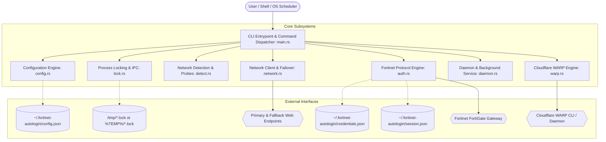
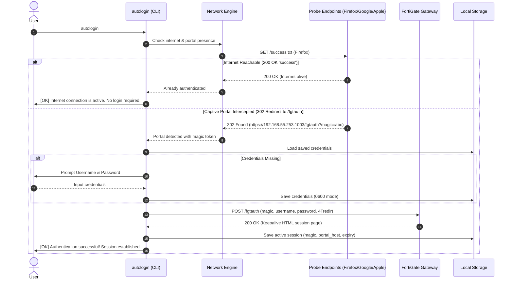
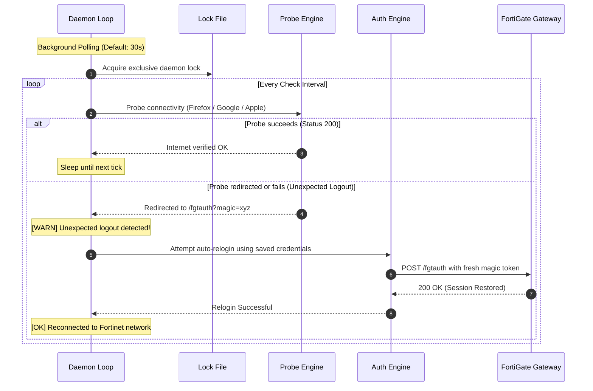

# System Architecture: Fortinet Auto-Login

This document details the software architecture, subsystem boundaries, data flow, concurrency model, and inter-process synchronization mechanisms of **Fortinet Auto-Login** (`autologin`).

---

## 1. High-Level Subsystem Architecture

The application is structured into decoupled modules, separating CLI input handling, configuration management, network probing, captive portal interaction, background daemon lifecycle, and Cloudflare WARP rotation.

---

## 2. Module Responsibilities & Source Map

| Source File | Responsibility |
| :--- | :--- |
| `src/main.rs` | CLI argument parsing, sub-command routing, colored terminal logging, interactive prompts, top-level error reporting. |
| `src/config.rs` | Configuration schema (`AppConfig`), persistent JSON storage (`config.json`), environment variable overrides, factory defaults. |
| `src/detect.rs` | Network environment inspection, Fortinet gateway detection, DNS/DHCP inspection, Wi-Fi SSID discovery. |
| `src/network.rs` | HTTP probe engine, primary and fallback check URL failover, TLS configuration, captive portal redirect extraction. |
| `src/auth.rs` | FortiGate `fgtauth` protocol client, session state persistence, magic token lifecycle, login/logout handshakes, keepalive countdown. |
| `src/lock.rs` | Cross-platform advisory file locking (`flock` on Unix, exclusive file sharing on Windows), preventing race conditions between CLI and daemon. |
| `src/daemon.rs` | Foreground polling daemon loop, event-driven network trigger integration, OS service installation (`launchd`, `systemd`, `schtasks`). |
| `src/warp.rs` | Cloudflare WARP Anycast IP and port matrix generator, UDP blackhole reachability testing, automated interface reset. |
| `src/updater.rs` | Self-updater, GitHub Releases tag query, binary asset download, atomic binary replacement. |
| `src/lib.rs` | Shared library exports, crate-level utilities, and unit testing harness. |

---

## 3. Core Workflows & Sequence Diagrams

### 3.1 Authentication Workflow (Interactive & CLI)

When a user or the background service initiates login, the system first verifies network connectivity to determine if authentication is required:

---

### 3.2 Daemon Execution & Unexpected Logout Recovery

The daemon continuously monitors the connection. If the firewall drops the session (due to idle timeouts, DHCP renewals, or firewall failovers), the daemon instantly recovers:

---

## 4. Concurrency & Process Locking Architecture

To guarantee that multiple instances (e.g., a background `systemd` daemon and a manual `autologin -status` CLI command) do not collide or corrupt session files, the application implements fine-grained advisory file locking.

### Lock Hierarchy

1. **`daemon.lock`**: Acquired exclusively by the running daemon process. Prevents multiple daemon processes from running concurrently.
2. **`auth.lock`**: Acquired during the login/logout handshake (short duration: ~100–300 ms). If the daemon is in the middle of re-authenticating, a manual CLI login waits or detects the in-flight operation.
3. **`warp.lock`**: Acquired while WARP Anycast endpoints are being rotated to prevent simultaneous network interface resets.

### Cross-Platform Locking Mechanics

- **Unix (macOS / Linux)**: Implemented using POSIX advisory record locking via `libc::flock(fd, LOCK_EX | LOCK_NB)`. Locks are automatically released by the kernel if a process terminates or crashes unexpectedly.
- **Windows**: Implemented using the Win32 `CreateFileW` API with sharing flag set to `0` (`FILE_SHARE_NONE`). Any competing process attempting to open the file receives `ERROR_SHARING_VIOLATION`.

---

## 5. Memory Management & Performance Guarantees

1. **Zero Dynamic Runtime Overhead**: Pure compiled Rust code without any garbage collection or runtime VM pauses.
2. **Deterministic Resource Deallocation (RAII)**: Sockets, file descriptors, and locks are tied to scoped guards and released immediately upon exiting execution blocks.
3. **No External Shared Library Dependencies**: Compiles to a statically linked executable that runs out-of-the-box on clean OS installations without requiring Python, Node.js, or OpenSSL shared libraries.
