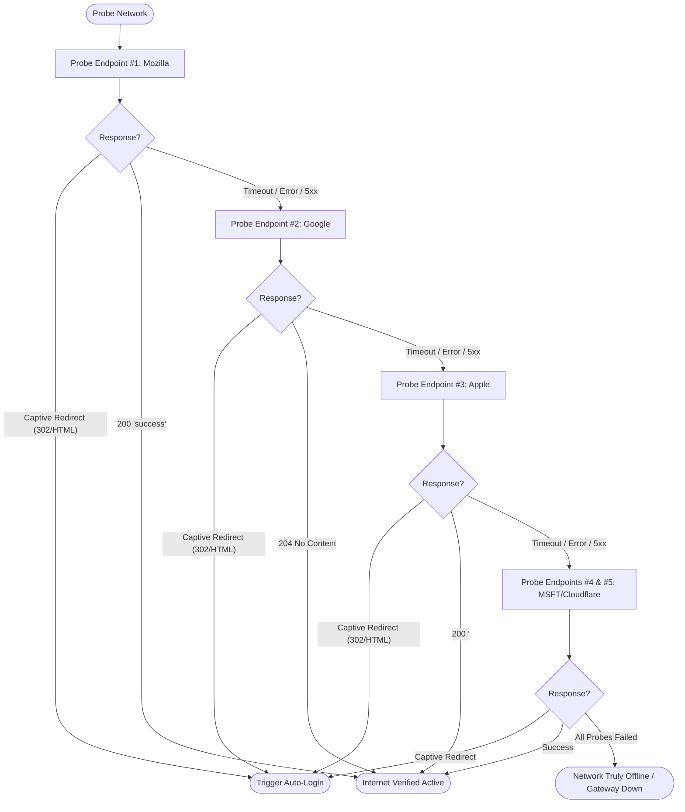

# Campus Customization & Failover Endpoints Guide

This guide explains how to customize **Fortinet Auto-Login** (`autologin`) for different university campuses, corporate offices, or branch locations, and how the multi-endpoint failover engine ensures high availability even when primary external check services experience outages.

---

## 1. Why Campus Customization is Required

Fortinet FortiGate firewalls are deployed globally, but network administrators configure them with institutional variations:

1. **Subnet & Gateway Addressing**: Different institutions allocate distinct private subnets to captive portal interfaces (e.g. `192.168.55.253`, `10.100.0.1`, `172.20.10.1`, or internal FQDNs like `firewall.university.edu`).
2. **Management Ports**: While HTTPS port `1003` is the standard FortiGate portal port, some networks use HTTP port `1000`, `8090`, `8443`, or standard `443`.
3. **Upstream Internet Censorship & CDN Outages**: Individual connectivity probe endpoints (like Mozilla's `detectportal.firefox.com`) can experience DNS throttling, regional blocking, or CDN downtime.

---

## 2. Configuration Architecture

`autologin` maintains a central configuration file at:
- **macOS / Linux**: `~/.fortinet-autologin/config.json`
- **Windows**: `%USERPROFILE%\.fortinet-autologin\config.json`

### Default Configuration Schema

When initialized without a config file, `autologin` uses the following defaults:

```json
{
  "portal_host": "192.168.55.253:1003",
  "check_urls": [
    "http://detectportal.firefox.com/success.txt",
    "http://connectivitycheck.gstatic.com/generate_204",
    "http://captive.apple.com/hotspot-detect.html",
    "http://www.msftconnecttest.com/connecttest.txt",
    "http://cp.cloudflare.com/generate_204"
  ],
  "gateway_ports": [
    1003,
    1000
  ],
  "daemon_interval_secs": 30,
  "request_timeout_secs": 5,
  "max_retries": 3
}
```

---

## 3. Multi-Endpoint Connectivity & Failover Probes

To guarantee maximum reliability, `autologin` does not rely on any single external probe server. Instead, it queries a prioritized chain of enterprise captive portal endpoints across different global CDNs:

| Priority | Endpoint URL | Provider | Expected Healthy Response |
| :---: | :--- | :--- | :--- |
| **1 (Primary)** | `http://detectportal.firefox.com/success.txt` | Mozilla / Fastly | HTTP `200 OK` with body containing `success` |
| **2 (Fallback)** | `http://connectivitycheck.gstatic.com/generate_204` | Google Global Cache | HTTP `204 No Content` |
| **3 (Fallback)** | `http://captive.apple.com/hotspot-detect.html` | Apple CDN / Akamai | HTTP `200 OK` with body containing `<TITLE>Success</TITLE>` |
| **4 (Fallback)** | `http://www.msftconnecttest.com/connecttest.txt` | Microsoft Azure | HTTP `200 OK` with body containing `Microsoft Connect Test` |
| **5 (Fallback)** | `http://cp.cloudflare.com/generate_204` | Cloudflare Anycast | HTTP `204 No Content` |

### Failover Algorithm



1. The client attempts the primary URL.
2. If the response indicates **captive portal redirection** (HTTP `302`, `Location` header containing `/fgtauth`, or HTML redirect script), the detection halts immediately and passes the extracted `magic` challenge to the authentication engine.
3. If the primary URL is **unreachable, times out, or returns a 5xx error**, the client seamlessly falls back to the next endpoint in the array without throwing a false positive error.
4. Only if **all 5 endpoints** fail to respond does the client conclude that the network interface lacks an active IP link or gateway route.

---

## 4. Configuration Management via CLI

`autologin` provides dedicated CLI commands to inspect and update configuration settings:

### View Current Configuration
```bash
autologin -config
# or
autologin -config show
```
*Output:*
```text
[CONFIG] Active Campus & Failover Configuration:
  Config File:       /Users/username/.fortinet-autologin/config.json
  Portal Host:       192.168.55.253:1003
  Gateway Ports:     [1003, 1000]
  Daemon Interval:   30s
  Request Timeout:   5s
  Max Retries:       3
  Check URLs (5 prioritized probe endpoints):
    1. http://detectportal.firefox.com/success.txt
    2. http://connectivitycheck.gstatic.com/generate_204
    3. http://captive.apple.com/hotspot-detect.html
    4. http://www.msftconnecttest.com/connecttest.txt
    5. http://cp.cloudflare.com/generate_204
```

### Update Campus Gateway Host
To point `autologin` to a different campus gateway IP or port:
```bash
autologin -config set-host 10.0.1.1:1003
```
*Output:*
```text
[CONFIG] Updated portal host to: 10.0.1.1:1003
[CONFIG] Saved configuration to /Users/username/.fortinet-autologin/config.json
```

### Reset to Factory Defaults
To restore original default campus settings:
```bash
autologin -config reset
```

### Temporary Host Override (Single Run)
If you are temporarily connected to another campus network or testing a gateway:
```bash
autologin -host 172.16.0.254:1003
```

---

## 5. Environment Variable Overrides

For headless servers, Docker containers, or CI/CD pipelines, settings can be overridden via environment variables without modifying `config.json`:

| Environment Variable | Description | Example |
| :--- | :--- | :--- |
| `FORTINET_PORTAL_HOST` | Overrides the FortiGate gateway host and port. | `export FORTINET_PORTAL_HOST="10.20.0.1:1003"` |
| `FORTINET_CHECK_URL` | Overrides the primary connectivity check URL. | `export FORTINET_CHECK_URL="http://intra.campus.edu/check"` |
| `FORTINET_INTERVAL` | Overrides the daemon polling frequency in seconds. | `export FORTINET_INTERVAL="45"` |

---

## 6. Real-World Customization Examples

### Scenario A: University with Alternate Subnet (`10.10.1.1:1003`)
```bash
autologin -config set-host 10.10.1.1:1003
autologin
```

### Scenario B: Custom Intranet Probe in Restricted Enterprise
Edit `~/.fortinet-autologin/config.json`:
```json
{
  "portal_host": "192.168.10.1:8090",
  "check_urls": [
    "http://connectivity.internal.corp/status",
    "http://detectportal.firefox.com/success.txt"
  ],
  "gateway_ports": [8090, 80],
  "daemon_interval_secs": 20,
  "request_timeout_secs": 3,
  "max_retries": 5
}
```
All CLI runs and the background daemon immediately adopt the updated intranet parameters upon next execution.
