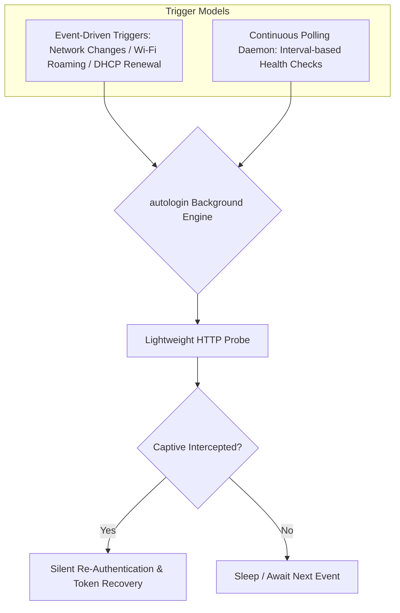

# Cross-Platform Daemon & Background Service Architecture

This document describes the design, implementation, and cross-platform service integration for the **Fortinet Auto-Login** background daemon across **macOS**, **Linux**, and **Windows**.

---

## 1. Operating Modes Overview

The background service operates under two complementary models:



1. **Event-Driven Execution**: Triggered instantly by OS network state transitions (e.g., waking from sleep, roaming between Wi-Fi APs, connecting Ethernet, or DHCP re-lease).
2. **Periodic Polling Daemon**: Continuously checks connectivity at an interval (default: 30 seconds), preventing silent idle timeouts and detecting unsolicited firewall session terminations.

---

## 2. Platform-Specific Background Implementations

### 2.1 macOS: `launchd` LaunchAgent

On macOS, `autologin` integrates with the native system service manager, `launchd`. It leverages `WatchPaths` to achieve sub-second event-driven triggers when network configurations change.

- **Plist Location**: `~/Library/LaunchAgents/com.fortinet.autologin.plist`
- **Watched Paths**:
  - `/Library/Preferences/SystemConfiguration/com.apple.airport.preferences.plist` (Wi-Fi SSID associations & roaming)
  - `/Library/Preferences/SystemConfiguration/NetworkInterfaces.plist` (Interface up/down states)
- **Plist Configuration**:
```xml
<?xml version="1.0" encoding="UTF-8"?>
<!DOCTYPE plist PUBLIC "-//Apple//DTD PLIST 1.0//EN" "http://www.apple.com/DTDs/PropertyList-1.0.dtd">
<plist version="1.0">
<dict>
    <key>Label</key>
    <string>com.fortinet.autologin</string>
    <key>ProgramArguments</key>
    <array>
        <string>/usr/local/bin/autologin</string>
        <string>-daemon</string>
        <string>-interval</string>
        <string>30s</string>
    </array>
    <key>RunAtLoad</key>
    <true/>
    <key>KeepAlive</key>
    <true/>
    <key>WatchPaths</key>
    <array>
        <string>/Library/Preferences/SystemConfiguration/com.apple.airport.preferences.plist</string>
        <string>/Library/Preferences/SystemConfiguration/NetworkInterfaces.plist</string>
    </array>
    <key>StandardOutPath</key>
    <string>/tmp/autologin.log</string>
    <key>StandardErrorPath</key>
    <string>/tmp/autologin.log</string>
</dict>
</plist>
```

**Service Commands:**
```bash
# Install and start service
autologin -service install

# Verify status
launchctl list | grep fortinet

# Uninstall service
autologin -service uninstall
```

---

### 2.2 Linux: `systemd` User Service

On Linux, `autologin` deploys as a `systemd --user` service unit that runs in the unprivileged user session.

- **Unit File Location**: `~/.config/systemd/user/fortinet-autologin.service`
- **Service Definition**:
```ini
[Unit]
Description=Fortinet Captive Portal Auto-Login Daemon
After=network-online.target
Wants=network-online.target

[Service]
Type=simple
ExecStart=/usr/local/bin/autologin -daemon -interval 30s
Restart=always
RestartSec=5
StandardOutput=append:%t/autologin.log
StandardError=append:%t/autologin.log

[Install]
WantedBy=default.target
```

**Service Lifecycle Commands:**
```bash
# Automated install via CLI
autologin -service install

# Manual inspection via systemctl
systemctl --user status fortinet-autologin.service
journalctl --user-unit fortinet-autologin.service -f
```

---

### 2.3 Windows: Task Scheduler (`schtasks`)

On Windows, the daemon runs in the user's interactive logon session using the Windows Task Scheduler.

- **Task Name**: `FortinetAutoLoginDaemon`
- **Trigger**: Runs at user logon (`/SC ONLOGON`) and restarts automatically if terminated.
- **Creation Command**:
```cmd
schtasks.exe /Create /TN "FortinetAutoLoginDaemon" /TR "\"C:\Users\User\bin\autologin.exe\" -daemon -interval 30s" /SC ONLOGON /RL HIGHEST /F
```

**Service Lifecycle Commands:**
```powershell
# Automated install via CLI
autologin.exe -service install

# Query task status
schtasks.exe /Query /TN "FortinetAutoLoginDaemon" /FO LIST

# Automated uninstall
autologin.exe -service uninstall
```

---

## 3. Inter-Process Synchronization & Advisory File Locking

Because the background daemon runs continuously while a user may execute manual CLI commands (e.g. `autologin`, `autologin -status`, `autologin -logout`), robust synchronization is critical to avoid race conditions and file corruption.

### Cross-Platform Locking Implementation

| Platform | System Mechanism | Implementation in `src/lock.rs` | Behavior on Contention |
| :--- | :--- | :--- | :--- |
| **macOS / Linux** | POSIX `flock(2)` | `libc::flock(fd, LOCK_EX \| LOCK_NB)` | Non-blocking query returns `EWOULDBLOCK` if lock is held. |
| **Windows** | Win32 `CreateFileW` | `share_mode(0)` (`FILE_SHARE_NONE`) | Returns `ERROR_SHARING_VIOLATION` if another process holds the handle. |

### Guarantees
1. **Crash Safety**: All locks are kernel-backed file descriptor locks. If a process panics or is killed with `SIGKILL`, the operating system immediately releases the lock.
2. **Deterministic CLI Coordination**: When `autologin` runs manually to perform a login or logout, it acquires the short-lived `auth.lock`. The daemon yields gracefully while the CLI completes its handshake.

---

## 4. Signal Handling & Clean Shutdown

The daemon catches standard termination signals to ensure lock cleanup and graceful exits:

- **macOS / Linux**: Listens for `SIGINT` (Ctrl+C) and `SIGTERM` (sent by `systemctl stop` or `launchctl unload`).
- **Windows**: Handles `CTRL_C_EVENT` and `CTRL_BREAK_EVENT` via console control handlers.
- **Cleanup Sequence**:
  1. Interrupts the current sleep timer.
  2. Completes any in-flight HTTP request.
  3. Releases file locks.
  4. Flushes and closes log file descriptors.
  5. Exits cleanly with status code `0`.

---

## 5. Centralized Logging & Log Streaming

All daemon events are formatted uniformly and written to the daemon log file (`/tmp/autologin.log` or `%TEMP%\autologin.log`).

### Consistent Log Format
```text
[HH:MM:SS] [TAG]     Message
```

### CLI Log Tools
```bash
# View last 40 lines of daemon activity
autologin -logs

# Live tail (stream) logs
autologin -logs -f

# Clear daemon log file
autologin -logs -clear
```

### Automatic Log Rotation
To protect local disk space, `autologin` enforces an automatic rotation limit:
- When `autologin.log` exceeds **2 MB**, it is renamed to `autologin.log.old`, and a new empty log file is created.
- Total disk usage for logs never exceeds 4 MB.
