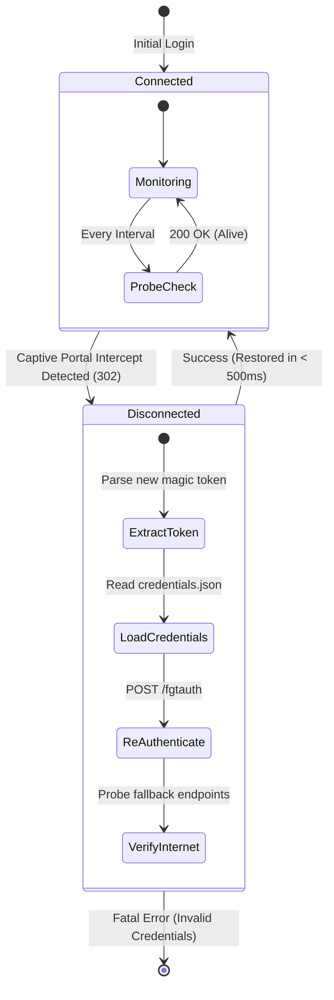

# Fortinet FortiGate Captive Portal Protocol Specification

This document details the reverse engineering findings, protocol state machine, HTTP handshakes, and session lifecycle mechanisms of the Fortinet FortiGate Captive Portal implemented in **Fortinet Auto-Login**.

---

## 1. Captive Portal Interception Mechanics

When an unauthenticated endpoint connects to an enterprise network governed by a FortiGate firewall:

1. **DNS Resolution**: The firewall either allows plain DNS queries (UDP 53) or intercepts them to resolve internet hostnames to valid external IP addresses.
2. **HTTP Interception (TCP Port 80)**: When the client opens a TCP connection to an unauthenticated external HTTP server (such as `http://detectportal.firefox.com/success.txt`), the FortiGate firewall intercepts the TCP stream at the gateway layer.
3. **HTTP 302 Redirect**: Instead of forwarding the request to the upstream internet, the firewall responds immediately with an HTTP `302 Found` (or an HTML meta-refresh / JavaScript redirect) directing the client to its internal authentication gateway:

```http
HTTP/1.1 302 Found
Location: https://192.168.55.253:1003/fgtauth?magic=0b0c034a70659db0&4Tredir=http%3A%2F%2Fdetectportal.firefox.com%2Fsuccess.txt
Connection: close
Content-Length: 0
```

---

## 2. Protocol Anatomy & Parameters

### 2.1 The Magic Token (`magic`)

The `magic` parameter is a dynamic, hexadecimal session identifier generated by the FortiGate authentication daemon (`authd`) per IP/MAC challenge.

- **Format**: An 8-to-16-character hexadecimal string (e.g., `0b0c034a70659db0`).
- **Scope**: Ephemeral and single-use for authentication. Once authenticated, the same `magic` token represents the active session until logged out or timed out.
- **Extraction**: The CLI extracts the token using regex matching against both HTTP headers and response HTML:
  ```regex
  (?:fgtauth\?|magic=)([a-fA-F0-9]{8,16})
  ```

### 2.2 Redirect Target (`4Tredir`)

The `4Tredir` parameter encodes the destination URL the user originally attempted to visit. After successful authentication, FortiGate's web server uses this parameter to redirect the client back to their original target.

---

## 3. The Authentication Handshake

To authenticate, the client must submit an HTTP `POST` request to the `/fgtauth` endpoint on the FortiGate gateway host and port.

### Request Specification

```http
POST /fgtauth HTTP/1.1
Host: 192.168.55.253:1003
User-Agent: Mozilla/5.0 (Macintosh; Intel Mac OS X 10_15_7) AppleWebKit/537.36
Content-Type: application/x-www-form-urlencoded
Content-Length: 98
Connection: close

4Tredir=http%3A%2F%2Fdetectportal.firefox.com%2Fsuccess.txt&magic=0b0c034a70659db0&answer=1&username=user123&password=secretpassword
```

### Form Field Definitions

| Parameter | Type | Required | Description |
| :--- | :--- | :---: | :--- |
| `4Tredir` | URL Encoded String | Yes | Original target URL (e.g. `http://detectportal.firefox.com/success.txt`). |
| `magic` | Hex String | Yes | The challenge token extracted from the captive portal redirect. |
| `answer` | Integer (`1`) | Yes | Signals user acknowledgment and acceptance of network policy. |
| `username` | String | Yes | The user's RADIUS, LDAP, or local FortiGate credentials. |
| `password` | String | Yes | The user's account password. |

---

## 4. Response Evaluation & Session Verification

FortiGate's authentication responses are evaluated by inspecting both the HTTP status code and the response HTML body:

### 4.1 Successful Authentication

A successful login returns an HTTP `200 OK` containing the FortiGate Keepalive Window HTML:

```html
<!DOCTYPE html PUBLIC "-//W3C//DTD HTML 4.01 Transitional//EN">
<html>
<head>
<title>Firewall Authentication Keepalive Window</title>
<script type="text/javascript">
function keepalive() {
    location.href = "keepalive?0b0c034a70659db0";
}
function logout() {
    location.href = "logout?0b0c034a70659db0";
}
</script>
</head>
<body onload="setInterval(keepalive, 60000);">
<h3>Authentication Successful</h3>
<p>Do not close this window to keep your internet connection active.</p>
</body>
</html>
```

**Indicators of Success:**
1. Body contains `"Firewall Authentication Keepalive Window"`, `"keepalive?"`, or `"Authentication Successful"`.
2. Follow-up probe to `http://detectportal.firefox.com/success.txt` returns `200 OK` with raw content `success\n`.

### 4.2 Authentication Failures

| Response Signature | Cause | Client Action |
| :--- | :--- | :--- |
| HTML contains `"Authentication Failed"` or `"Invalid username or password"` | Invalid credentials | Return error code 1, notify user to verify credentials. |
| Redirect back to `/fgtauth` with a new `magic` token | Expired token / stale challenge | Re-fetch fresh `magic` token and retry once. |
| Connection Timed Out / Host Unreachable | Client not connected to campus Wi-Fi | Return error indicating FortiGate gateway is inaccessible. |

---

## 5. Session Keepalive Mechanism

FortiOS enforces idle session timers. If a client generates no network traffic or if the captive portal profile mandates periodic keepalive handshakes:

- **Keepalive Endpoint**: `GET https://<portal_host>/keepalive?<magic>`
- **Cadence**: Typically every 60–300 seconds.
- **Response**: Returns HTTP 200 with an updated countdown timer HTML page.
- **Client Handling**: In `autologin -daemon` mode, active network probing double-acts as an implicit NAT traffic generator and session health check.

---

## 6. Unexpected Logout Recovery

In real-world university and corporate campus environments, clients experience spontaneous logouts due to:

1. **IP Re-lease (DHCP Renewal)**: When moving between Wi-Fi access points (APs), DHCP may issue a new IP address or subnet mask. FortiGate ties the session table to `(IP, MAC, Magic)`; an IP shift immediately terminates the session.
2. **Concurrent Login Preemption**: Another device logging in under the same student or employee ID if the firewall profile restricts concurrent sessions.
3. **Session Expiry / Firewall Cluster Sync**: Network admin maintenance or HA failover events clearing transient NAT state.

### Detection & Automated Recovery Loop



1. **Continuous Probe**: Every interval (default: 30 seconds), `autologin` performs a lightweight HTTP probe to the probe endpoint.
2. **302 Interception Detected**: If the response is redirected to `/fgtauth?magic=...`, `autologin` detects the session drop.
3. **Sub-second Relogin**: `autologin` parses the new `magic` token, constructs a valid POST payload with saved credentials, and submits it to `/fgtauth`.
4. **Zero User Friction**: The entire recovery cycle finishes in under 500 milliseconds, before applications (e.g., SSH sessions, video calls, IDEs) sever their underlying connections.

---

## 7. Graceful Logout Handshake

To terminate an active session cleanly without leaving lingering state on the firewall:

- **Endpoint**: `GET https://<portal_host>/logout?<magic>`
- **Processing**:
  1. The client loads the active `session.json`.
  2. Submits the logout request with the active `magic` token.
  3. FortiGate invalidates the session and deletes the NAT mapping for the client IP.
  4. Local `session.json` cache is purged.
