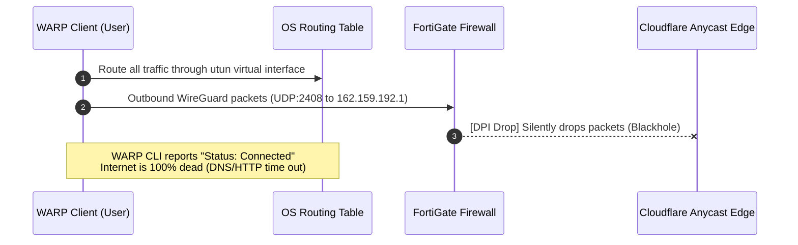
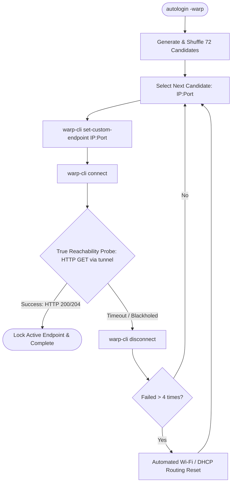

# Cloudflare WARP Auto-Rotation & Evasion Engine

This document details the reverse engineering, architecture, and implementation of the **Cloudflare WARP Auto-Rotation Engine** in `autologin -warp`, designed to bypass enterprise firewall DPI blocks and UDP blackholes.

---

## 1. Problem Statement: The UDP Blackhole Effect

On corporate and university campus networks protected by Fortinet FortiGate firewalls:

1. **Protocol Censorship / DPI**: The firewall's Deep Packet Inspection engines detect standard WireGuard / WARP protocol headers over default UDP port `2408`.
2. **Silent Packet Dropping (The UDP Blackhole)**: Rather than sending an explicit TCP RST or ICMP Port Unreachable packet, the firewall silently discards outgoing UDP packets directed to known Cloudflare edge endpoints.
3. **The False-Positive Trap**: Because UDP is a connectionless protocol, the Cloudflare WARP client (`warp-svc` / `warp-cli`) marks the connection as **"Connected"** as soon as it binds local sockets. The operating system updates its default route to point to the `utun` / `wg0` virtual interface. However, because packets are swallowed by the firewall, all DNS resolutions and web requests hang indefinitely.



---

## 2. Solution: Multi-Port Anycast Auto-Rotation

To defeat UDP filtering, `autologin -warp` implements an automated rotation algorithm that pairs Cloudflare Anycast edge IP ranges with alternative ports commonly whitelisted by enterprise firewalls for legacy VPN tunnels (such as IPsec and L2TP).

### 2.1 The 72-Endpoint Candidate Matrix

Cloudflare operates Anycast edge routers that accept WireGuard encapsulation across multiple IP pools and alternative UDP ports:

#### Anycast IP Pools (12 Primary Subnets)
- `162.159.192.0/24` (Pool 1: `162.159.192.1` – `162.159.192.10`)
- `162.159.193.0/24` (Pool 2: `162.159.193.1` – `162.159.193.10`)
- `162.159.195.0/24` (Pool 3: `162.159.195.1` – `162.159.195.10`)
- `188.114.96.0/24`  (Pool 4: `188.114.96.1` – `188.114.96.10`)
- `188.114.97.0/24`  (Pool 5: `188.114.97.1` – `188.114.97.10`)
- `188.114.98.0/24`  (Pool 6: `188.114.98.1` – `188.114.98.10`)
- `188.114.99.0/24`  (Pool 7: `188.114.99.1` – `188.114.99.10`)
- Additional Anycast clusters (`162.159.204.x`, `162.159.205.x`, etc.)

#### Evasion Ports (6 Ports)
| Port | Protocol Association | Firewall Behavior |
| :---: | :--- | :--- |
| **500** | IPsec IKE | Universally allowed across enterprise firewalls for legacy corporate VPNs. |
| **4500** | IPsec NAT-Traversal | Whitelisted across virtually all institutional firewalls. |
| **1701** | L2TP | Often left unrestricted for backwards VPN compatibility. |
| **80** | HTTP | Rarely subject to UDP protocol blocks when UDP is permitted. |
| **443** | HTTPS / QUIC | Frequently whitelisted for HTTP/3 and QUIC traffic. |
| **2408** | Default WARP | Standard port (tested as baseline). |

**Combinatorial Space**: 12 IP pools × 6 ports = **72 candidate combinations**.

---

## 3. Rotation & Verification Algorithm



### Key Execution Stages

1. **Intelligent Endpoint Sampling**:
   - `autologin` shuffles the candidate matrix, prioritizing high-probability ports (`500` and `4500`) across disparate IP pools.
2. **Active Reachability Probing**:
   - Instead of checking `warp-cli status`, `autologin` dispatches real HTTP requests to the probe endpoints (`http://detectportal.firefox.com/success.txt` and fallbacks) through the newly established tunnel.
   - A strict **3-second timeout** prevents long terminal hangs.
3. **Blackhole Detection**:
   - If the HTTP probe fails or times out within 3 seconds, `autologin` flags the endpoint as blackholed:
     ```text
     [WARN]   Endpoint 162.159.192.1:500 connected to tunnel but internet is unreachable (UDP blackholed).
     ```
   - It immediately tears down the tunnel (`warp-cli disconnect`) and proceeds to the next candidate.
4. **Automated Wi-Fi / Network Stack Recovery**:
   - Repeated virtual adapter binding can occasionally pollute local routing tables or stale DNS resolvers. If 4 consecutive candidates fail, `autologin` triggers an interface DHCP refresh to restore clean routing before continuing.
5. **Session Lock**:
   - Upon finding a working endpoint (e.g. `162.159.192.1:4500`), `autologin` outputs the success banner and preserves the configuration.

---

## 4. Usage Commands

### Connect WARP with Auto-Rotation
```bash
autologin -warp
```
*Sample Output:*
```text
[DETECT] Checking network environment and Fortinet presence...
[OK]     Fortinet network detected (Gateway: 192.168.55.253:1003)
[WARP]   Initializing intelligent Cloudflare WARP auto-rotation...
         Generated 72 candidate endpoint combinations across 12 Anycast IP pools
[WARP]   Testing endpoint [1/8]: 162.159.192.1:500...
         Verifying internet reachability through 162.159.192.1:500...
[WARN]   Endpoint 162.159.192.1:500 connected to tunnel but internet is unreachable (UDP blackholed).
[WARP]   Testing endpoint [2/8]: 162.159.192.1:4500...
         Verifying internet reachability through 162.159.192.1:4500...
[OK]     Success! Connected to Cloudflare WARP via 162.159.192.1:4500 (Internet verified active)
```

### Disconnect WARP & Restore Native Network Routing
```bash
autologin -warp-disconnect
```
*Sample Output:*
```text
[WARP]   Disconnecting Cloudflare WARP and restoring native network routing...
[OK]     WARP disconnected. Native campus network routing restored.
```
