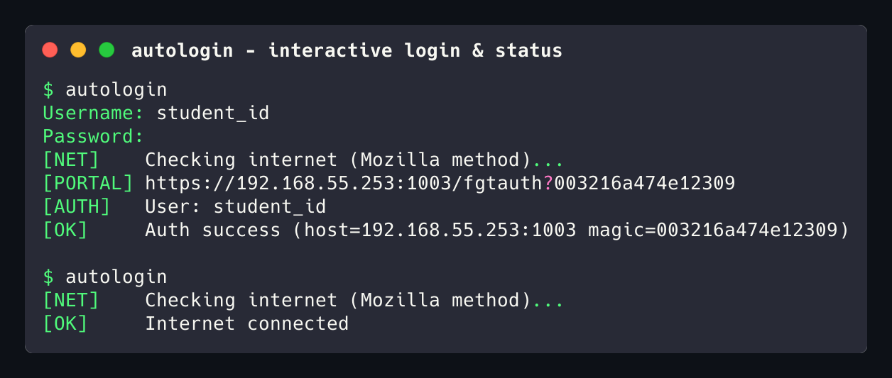
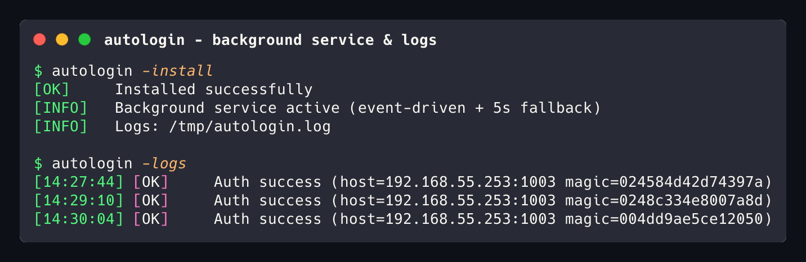

# fortinet-auto-login

A fast, zero-dependency CLI that automates login, logout, and session keepalive for FortiGate captive portals (the popup requiring username/password and a persistent keepalive tab). Written in Go, cross-compiles for macOS, Linux, and Windows.



## Features

- **Zero-Touch Login**: Automatically detects captive portal redirects and authenticates using FortiGate's one-time `magic` token.
- **Secure Credentials**: Prompts interactively with hidden input on first run and saves locally to `~/.fortinet-autologin/credentials.json` (`0600` permissions).
- **macOS Background Service**: One-command background installation (`-install`) via macOS `LaunchAgent` triggered automatically on Wi-Fi state changes.
- **Continuous Daemon**: Built-in `-daemon` mode for continuous polling and transparent re-authentication.
- **SSID Filtering**: Optional Wi-Fi network filtering so credentials are only used on designated networks.
- **Live Logs**: Instantly view daemon and background logs with `autologin -logs`.
- **Keepalive & Logout**: Keep sessions alive before timeout or cleanly terminate active sessions.

## How It Works

FortiGate captive portals redirect unauthenticated HTTP requests to a login page with a one-time `magic` token in the query string. This tool:

1. Checks connectivity via `http://detectportal.firefox.com/`.
2. Intercepts portal redirects and submits credentials with the captured `magic` token.
3. Saves session details (host, token, timeout) locally to handle keepalive or logout without browser overhead.
4. Transparently re-authenticates whenever network access drops.

<details>
<summary>View FortiGate Captive Portal Screenshot</summary>

<br>


</details>

## Installation

### Download from Releases

Download the latest pre-compiled binary for your OS from the [Releases](../../releases/latest) page.

```bash
# Make executable (macOS / Linux)
chmod +x fortinet-auto-login-*

# Move to your PATH
sudo mv fortinet-auto-login-* /usr/local/bin/autologin
```

### Build from Source

```bash
go build -o autologin .
```

Cross-compilation:
```bash
# macOS (Apple Silicon)
GOOS=darwin GOARCH=arm64 go build -o autologin-mac .

# Windows
GOOS=windows GOARCH=amd64 go build -o autologin.exe .

# Linux
GOOS=linux GOARCH=amd64 go build -o autologin-linux .
```

## Usage

```bash
autologin [flags]
```

| Flag / Command | Shorthand | Default | Category | Description |
| --- | --- | --- | --- | --- |
| *(default)* | | | Auth | Authenticate / login to captive portal |
| `-u`, `-p` | `-username`, `-password` | | Auth | Provide or update stored portal credentials |
| `-logout` | `-l` | `false` | Auth | Log out of active captive portal session |
| `-status` | `-detect` | `false` | Diagnostic | Inspect internet, Fortinet hardware signature & active session |
| `-service <action>` | | | Service | Manage background service: `install` or `uninstall` |
| `-daemon` | `-d` | `false` | Daemon | Run continuous monitoring daemon in foreground |
| `-interval` | `-i` | `45s` | Daemon | Polling interval for daemon |
| `-logs` | | `false` | Logs | View recent background daemon logs (last 40 lines) |
| `-logs -f` | `-follow` | `false` | Logs | Live stream / follow logs in real time (like `tail -f`) |
| `-logs -clear` | `-clean` | `false` | Logs | Truncate and clear background log file |
| `-n <count>` | | `40` | Logs | Specify number of log lines to show (0 for all) |
| `-upgrade` | | `false` | Maintenance | Download & atomically update binary from GitHub |
| `-version` | `-v` | `false` | Info | Print version information |

### Examples

**Standard login (prompts on first run):**
```bash
autologin
```

**Update saved credentials:**
```bash
autologin -u <username> -p <password>
```

**Run in daemon mode:**
```bash
autologin -d -i 30s
```

**Log out of active session:**
```bash
autologin -logout
```

## Background Automation



### macOS (LaunchAgent)

On macOS, you can install an event-driven `LaunchAgent` that runs automatically in the background whenever Wi-Fi state changes:

```bash
# Install and activate the background service
autologin -install

# View recent background logs
autologin -logs

# Uninstall the service
autologin -uninstall
```

> [!NOTE]
> The `-install` and `-uninstall` background service is currently only supported on **macOS**.
>
> **Linux & Windows (TODO / Help Needed)**: Native background service support (such as systemd units or Windows Task Scheduler) is currently on the roadmap. Contributions are welcome!
>
> In the meantime, Linux and Windows users can run `autologin` in daemon mode:
> ```bash
> autologin -daemon -interval 30s &
> ```

## Configuration

Credentials and session state are cached in `~/.fortinet-autologin/`.

### SSID Filtering (Optional)

You can restrict authentication to specific Wi-Fi networks by adding an `ssid` entry to `~/.fortinet-autologin/credentials.json`:

```json
{
  "username": "your_username",
  "password": "your_password",
  "ssid": "Campus-WiFi, Lab-WiFi"
}
```

When set, `autologin -auto` will verify the connected Wi-Fi network against your list before sending login requests.
